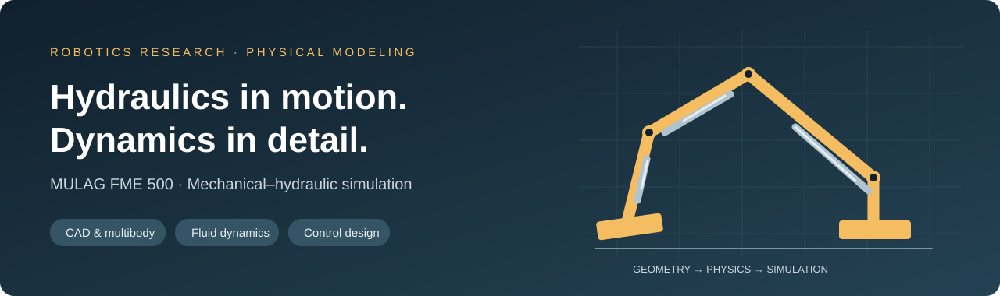
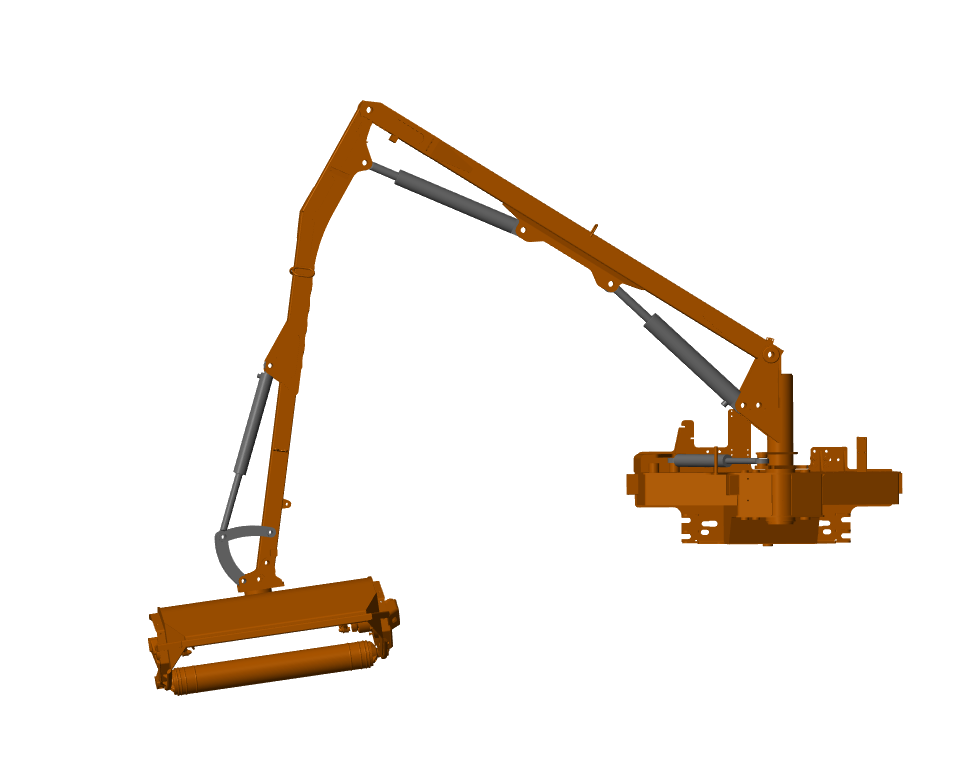
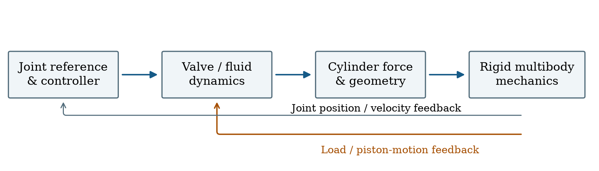

<div align="center">



# Hydraulic Manipulator Modeling

**A coupled mechanical–hydraulic model of the MULAG FME 500 embankment mower**

[Read the report](docs/report/hydraulic_manipulator_report_ieee.pdf) · [Open the model](#quick-start) · [Explore the results](#reported-results) · [Original files and videos](https://github.com/kevm98/hydraulic-manipulator-modeling/releases/tag/project-materials)

  

</div>

This research project connects CAD-derived arm geometry with hydraulic supply, valve, and cylinder dynamics in MATLAB/Simulink. It explores how fluid compressibility affects response timing and trajectory tracking, providing a plant model for further identification and control development.

**Author:** Kevin Kudakwashe Murera  
**Institution:** Robotics Research Lab, Department of Computer Science, RPTU Kaiserslautern-Landau

## The model

<div align="center">

</div>

| Layer | What is included |
| --- | --- |
| Mechanical structure | Five-coordinate arm, CAD-derived meshes, URDF variants, and Simscape Multibody models |
| Hydraulic plant | Pump, accumulator, relief elements, directional valves, and double-acting actuators |
| Reference generation | Inverse-kinematics scripts and original position, velocity, acceleration, and end-effector datasets |
| Feedback control | Embedded joint-level controller: backstepping-style branches plus a separate joint-2 PI/velocity/gravity branch |
| Analysis | Threshold-based response intervals, task-space error metrics, and a four-case bulk-modulus summary |



## Quick start

Use a licensed MATLAB installation with **Simulink, Simscape, Simscape Multibody, and Simscape Fluids**. Robotics System Toolbox is needed for the URDF/IK workflows. The integrated model was saved in **R2023b**; this is the recorded model version, not a claim that every MATLAB release has been tested.

Clone the repository, open its root folder in MATLAB, and run:

```matlab
open_project
```

This configures project paths and opens the editable model:

```text
models/Mulag_FME_500_with_cylinder.slx
```

To start a simulation explicitly:

```matlab
out = run_simulation;
```

The setup directs generated files into `build/`. Model geometry and Signal Editor references have been made relative to the project. No MATLAB runtime was available during this migration, so end-to-end simulation success is not claimed. See [setup and compatibility](docs/SETUP.md) for the required products, archived solver configuration, timing differences, and analysis workflow.

## Reported results


Four reported simulation cases vary bulk modulus from 0.5 to 2.0 GPa:

| Metric | 0.5 GPa | 2.0 GPa | Change |
| --- | ---: | ---: | ---: |
| Joint-1 50% response interval | 847.4 ms | 649.7 ms | 23.3% lower |
| End-effector RMS error | 827.9 mm | 739.4 mm | 10.7% lower |
| End-effector mean error | 211.3 mm | 228.8 mm | 8.3% higher |

The joint responses are not uniform: joint 4's reported interval increases with bulk modulus. These are historical simulation summaries, not new experiments or hardware-accuracy guarantees. The revised report explains the trends and reconciles conflicting values in the earlier report.

The [trajectory figure](docs/report/figures/task-space-path.pdf) is redrawn directly from the numerical curves stored in the original MATLAB FIG file. Exported CSVs and plot-generation code are included. The two spatial traces have different sample counts and no shared time vector, so they are not used to recompute tracking errors. See [data and figure provenance](docs/DATA_AND_FIGURES.md).

## Repository guide

```text
hydraulic-manipulator-modeling/
├── models/                 Integrated model, variants, and experimental libraries
├── src/
│   ├── kinematics/         Reference generation and geometry helpers
│   ├── analysis/           Delay and task-space analysis
│   ├── parameters/         Original parameter helpers
│   ├── robot/              Rigid-body-tree helpers
│   └── +custom_component/  Original Simscape component prototypes
├── robot/                  URDF descriptions and canonical STL meshes
├── data/                   Original references, saved metrics, and plot CSVs
├── docs/
│   ├── report/             Revised PDF, LaTeX, bibliography, and vector figures
│   ├── original/           Original report, manual, README, hashes, migration map
│   ├── presentations/     Original slides in PDF and PowerPoint
│   └── assets/             Repository cover and model illustrations
├── archive/                Earlier scripts and original MATLAB figures
├── scripts/                Figure generation and repository validation
├── setup_project.m         Path and build-folder configuration
├── open_project.m          Open the editable integrated model
└── run_simulation.m        Return a Simulink SimulationOutput
```

The complete original source ZIP, CAD working files within that ZIP, and original videos are preserved in the [project-materials release](https://github.com/kevm98/hydraulic-manipulator-modeling/releases/tag/project-materials). Generated caches, autosaves, platform-specific binaries, and repeated mesh directories are kept out of active source.

## Documentation

- [Rewritten IEEE-format report](docs/report/hydraulic_manipulator_report_ieee.pdf) and [editable LaTeX source](docs/report/main.tex)
- [Setup and model compatibility](docs/SETUP.md)
- [Data provenance and figure rebuilding](docs/DATA_AND_FIGURES.md)
- [Migration record and editorial corrections](docs/MIGRATION.md)
- [Report build instructions](docs/report/README.md)
- [Original written report](docs/original/mechanical_hydraulic_modeling_preprint.pdf) and [original presentation](docs/presentations/mechanical_hydraulic_modeling.pdf)

## Rebuild and check

Repository integrity checks require only Python 3:

```bash
python3 scripts/validate_repository.py
```

Regenerate figures from the versioned numeric CSVs:

```bash
python3 -m pip install -r scripts/requirements-figures.txt
python3 scripts/build_figures.py
```

Add `--extract-fig` to repeat extraction from the original MATLAB figure. The figure script does not run the hydraulic model. MATLAB native objects in several MAT files require MATLAB for full interpretation.

## Provenance and reuse

Imported from the [private RRLAB GitLab project](https://rrlab-git.cs.rptu.de/rrlab/thesis/master-project_kevin_k_murera_hydraulic-manipulator-modeling), main-branch snapshot `2e49a5cee36b7617cfd5cb8e44590e3a61694a40` (December 29, 2025). This is an organized file snapshot; the nine-commit GitLab history is not mirrored. The original GitLab project remains unchanged.

No formal project-wide license was supplied. The author, university, manufacturer, and third-party materials retain their respective rights; see [third-party notices](THIRD_PARTY_NOTICES.md). The revised report follows IEEEtran conference formatting and is not represented as an accepted or published IEEE paper.
