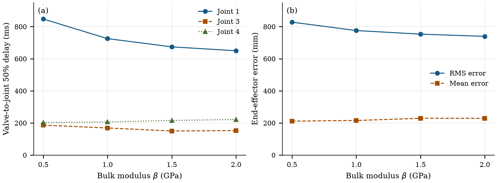
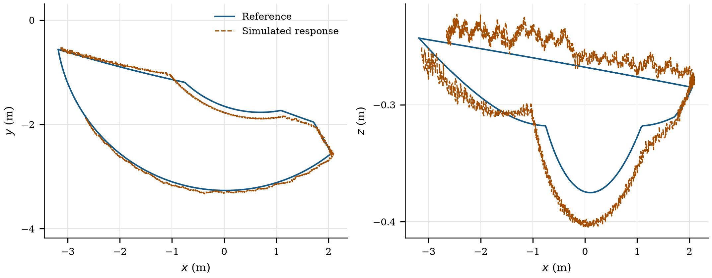

# Hydraulic Manipulator Modeling

Mechanical–hydraulic simulation of the **MULAG FME 500 embankment mower** in MATLAB and Simscape.

**Kevin Kudakwashe Murera**<br>
Robotics Research Lab, Department of Computer Science, RPTU Kaiserslautern-Landau

[Report](docs/report/hydraulic_manipulator_report_ieee.pdf) · [Setup](docs/SETUP.md) · [Full recordings](https://github.com/kevm98/hydraulic-manipulator-modeling/releases/tag/project-materials)

This project connects the arm's CAD-derived geometry with a hydraulic supply, directional valves, and double-acting cylinders. Cylinder motion changes chamber pressure and flow; hydraulic forces drive the multibody mechanism. A joint-level controller tracks a mowing trajectory so that response timing and positioning error can be studied together.

## Model and workflows

| Part | Contents |
| --- | --- |
| Mechanics | Five-coordinate arm, canonical STL meshes, URDF descriptions, and multibody models |
| Hydraulics | Pump, accumulator, relief elements, valves, and cylinders |
| Trajectories | Inverse kinematics and joint-position, velocity, acceleration, and end-effector datasets |
| Control | Backstepping-style feedback on four axes and a separate PI/velocity/gravity branch on joint 2 |
| Analysis | Threshold-based response intervals and time-weighted task-space error metrics |

## Open the model

Use MATLAB with Simulink, Simscape, Simscape Multibody, and Simscape Fluids. Robotics System Toolbox is needed for URDF and inverse-kinematics workflows. The integrated model was saved in **R2023b**.

From the repository root in MATLAB:

```matlab
open_project
```

To run the integrated model:

```matlab
out = run_simulation;
```

The entry points configure project-relative geometry and dataset paths, open the editable `.slx` model, and put generated files in `build/`. See [setup and compatibility](docs/SETUP.md) for solver settings, execution rates, and the analysis workflow. End-to-end execution still needs verification in a licensed MATLAB environment.

## Results



The reported study varies bulk modulus from 0.5 to 2.0 GPa while holding the controller configuration fixed.

| Metric | 0.5 GPa | 2.0 GPa |
| --- | ---: | ---: |
| Joint-1 50% response interval | 847.4 ms | 649.7 ms |
| End-effector RMS error | 827.9 mm | 739.4 mm |
| End-effector mean error | 211.3 mm | 228.8 mm |

Higher bulk modulus reduces the dominant joint's response interval and the reported RMS error. The effect varies by axis: joint 4's interval increases, and mean tracking error does not follow the RMS trend. The [report](docs/report/hydraulic_manipulator_report_ieee.pdf) discusses these differences and the limits of the simulation evidence.



*Reference and simulated paths extracted directly from the original MATLAB figure. The curves have different sample counts and no shared time vector, so tracking errors are not recomputed from these spatial exports.*

## Project structure

```text
models/             Integrated model, variants, and experimental libraries
src/kinematics/     Reference generation and geometry helpers
src/analysis/       Response timing and task-space metrics
src/parameters/     Parameter helpers
src/robot/          Rigid-body-tree helpers
src/+custom_component/  Simscape component prototypes
robot/              URDF files and STL meshes
data/               Reference datasets, saved metrics, and plot CSVs
docs/report/        Report, LaTeX source, bibliography, and figures
docs/presentations/ Original slides
docs/original/      Reference documents and file records
archive/            Earlier scripts and MATLAB figures
scripts/            Figure generation and repository checks
```

## Documentation

- [Report](docs/report/hydraulic_manipulator_report_ieee.pdf) and [LaTeX source](docs/report/main.tex)
- [Setup and compatibility](docs/SETUP.md)
- [Data and figure notes](docs/DATA_AND_FIGURES.md)
- [Implementation notes](docs/IMPLEMENTATION_NOTES.md)
- [Report build instructions](docs/report/README.md)

The complete project archive, CAD working files, and original recordings are available in the [project materials](https://github.com/kevm98/hydraulic-manipulator-modeling/releases/tag/project-materials).

## Rebuild figures and run checks

```bash
python3 -m pip install -r scripts/requirements-figures.txt
python3 scripts/build_figures.py
python3 scripts/validate_repository.py
```

Figures are generated from the saved numerical curves and summary tables. Repository checks cover model archives, referenced geometry and datasets, numerical exports, and documentation links.
